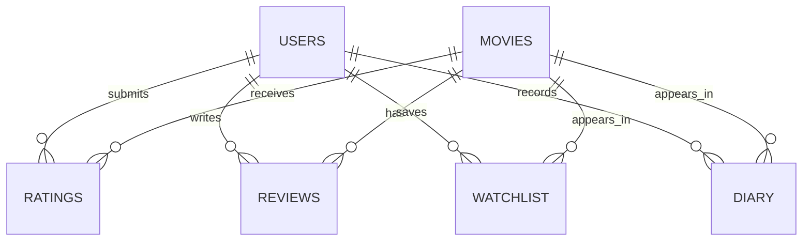

# Cinephile Lite

**Every film you watch, remembered.**

Cinephile Lite is a small, complete movie discovery and personal movie-tracking website made for a Third Year B.Tech Computer Engineering Web Technology Lab project. It has eight HTML interface pages, a beginner-friendly PHP JSON backend, and a six-table MySQL/MariaDB database. The app is intentionally simple enough to explain in a viva and modify without a framework.

## Project introduction

### Problem statement
Movie information is easy to find, but personal notes, ratings, and viewing history are often scattered across different places. Cinephile Lite keeps discovery and personal film memory together in one small application.

### Objectives and scope
The project demonstrates client-server communication, sessions, form validation, CRUD operations, relational database design, and responsive UI design. A user can browse the starter catalogue, register, log in, rate films, write reviews, save a watchlist, record watched dates in a diary, and view statistics. It is not a commercial recommendation engine: there is no external movie API, admin panel, social feed, payments, or production-scale moderation.

### Main features
The home page highlights starter films. Browse supports title search and genre filtering. A movie detail page contains live rating information, reviews, watchlist actions, and diary recording. Authenticated users have separate watchlist, diary, and profile pages. PHP protects all personal operations on the server.

## Technology in simple words

| Technology | Role in this project |
|---|---|
| HTML5 | Gives each page its structure: headings, forms, navigation, cards, and accessible labels. |
| CSS3 | Creates the dark cinematic visual design, responsive layout, poster cards, states, and small transitions. |
| Vanilla JavaScript | Listens for clicks and form submissions, calls PHP with `fetch()`, validates simple inputs, and updates the DOM. |
| PHP 8 | Runs backend endpoints, starts sessions, validates data again, and sends JSON responses. |
| MySQL/MariaDB | Stores users, movies, ratings, reviews, watchlist rows, and diary entries. |
| PDO | Gives PHP a safer, consistent way to connect to MySQL and use prepared statements. |
| Fetch API | Lets browser JavaScript call PHP endpoints without reloading every page. |

The main UI stays in HTML because the assignment explicitly asks for eight `.html` pages. PHP is reserved for server-side work where secrets, sessions, validation, and database access are needed.

## Local XAMPP setup

1. Install XAMPP or an equivalent Apache + PHP 8 + MySQL/MariaDB stack. On Linux, XAMPP is commonly installed under `/opt/lampp`; a distro Apache document root is often `/var/www/html`.
2. Copy the entire `Cinephile` folder into the web root. For XAMPP on Linux, one example is `sudo cp -r Cinephile /opt/lampp/htdocs/`.
3. Start Apache and MySQL from the XAMPP manager, or use `sudo /opt/lampp/lampp start`.
4. Open `http://localhost/phpmyadmin` in a browser. Create/import the separate database by using **Import** and selecting `sql/cinephile_simple.sql`. The script creates and uses `cinephile_simple`; it does not drop or modify an older `cinephile` database.
5. If your local credentials are not XAMPP's default `root` with an empty password, set `CINEPHILE_DB_HOST`, `CINEPHILE_DB_PORT`, `CINEPHILE_DB_NAME`, `CINEPHILE_DB_USER`, and `CINEPHILE_DB_PASS` in the Apache/PHP environment, or edit the clearly marked defaults in `backend/db.php`.
6. Open `http://localhost/Cinephile/index.html`. Do not open the pages with `file://`; PHP endpoints and sessions need Apache.
7. Register a real account, log in, browse a movie, submit a rating/review, add it to the watchlist, record a watched date, and open Profile.

### Fedora/Linux-friendly alternative
If you already have Apache, PHP, and MariaDB from your distribution, place the project in `/var/www/html/Cinephile`, enable the PHP MySQL extension, and import with a command like `mysql -u root -p < sql/cinephile_simple.sql`. Check permissions if Apache cannot read the directory. The exact service commands vary by Fedora version, so use `sudo systemctl start httpd mariadb` where those service names are installed.

### Common problems

- **Database connection unavailable:** confirm MySQL is running, import the SQL file, and check the values used by `backend/db.php`.
- **`could not find driver`:** install/enable PHP's MySQL PDO extension, usually named `php-mysql` or `php8.x-mysql`.
- **PHP pages show as downloads:** Apache is not processing PHP; enable the PHP module or use an XAMPP Apache installation.
- **Login works locally but not in an embedded HTTPS Preview:** the backend already sets `SameSite=None; Secure` when HTTPS/Preview headers are present. Plain HTTP local use keeps a compatible `SameSite=Lax` cookie.
- **Posters look like placeholders:** this is intentional. The starter data has optional `poster_path` values and the CSS poster art keeps the app usable without paid APIs or image keys.

## Architecture and request flow

The practical flow for saving a rating is:

`HTML form → JavaScript Fetch request → backend/ratings.php → PDO prepared statement → MySQL → JSON response → JavaScript updates the page`

For example, the movie page reads the selected movie ID from the URL, sends `{movie_id, stars}` as JSON to `ratings.php?action=save`, PHP checks the session and the 1–5 range, PDO updates the composite-key row, and JavaScript shows a confirmation and reloads the detail information.

## Database assignment notes

The schema is in `sql/cinephile_simple.sql` and defines exactly six application tables.

| Table | Purpose | Key details |
|---|---|---|
| `users` | Registered accounts. | Primary key `id`; unique `username` and `email`. |
| `movies` | Local starter catalogue. | Primary key `id`; indexed title, genre, and year. |
| `ratings` | One current 1–5 rating per user/movie. | Composite primary key `(user_id, movie_id)` and foreign keys to users/movies. |
| `reviews` | Written notes about movies. | Primary key `id`; many-to-one links to users and movies. |
| `watchlist` | Movies a user wants to watch. | Composite primary key `(user_id, movie_id)` prevents duplicates. |
| `diary` | Individual viewing entries. | Primary key `id`; repeat viewings are allowed with a `watched_date`. |

Foreign keys use cascading deletes so a removed user or movie does not leave orphaned personal rows. Passwords are hashed because the application should never store or display a plaintext password. Prepared statements keep request values separate from SQL code and help prevent SQL injection.

## Code walkthrough

- `backend/db.php` creates the PDO connection, sets exception mode, formats JSON, reads request data, validates IDs/dates, and checks movie existence.
- `backend/auth.php` owns session cookies, registration, login, logout, current-user status, and live profile counts.
- `backend/movies.php` handles list/search/genre/detail requests and calculates average ratings.
- `backend/ratings.php` validates 1–5 stars and uses the composite key to insert or update one user's rating.
- `backend/reviews.php` lists safe username/date data and stores validated review text.
- `backend/watchlist.php` uses `INSERT IGNORE` with its composite key and restricts deletes to the current user.
- `backend/diary.php` validates `YYYY-MM-DD`, stores repeat viewings, and checks ownership before deletion.
- `assets/js/app.js` is the page-aware controller. Functions such as `loadSession`, `createMovieCard`, `loadMoviePage`, and `renderProfile` keep browser responsibilities small.
- `assets/css/style.css` contains the shared tokens, navigation, hero, movie card, form, state, detail, collection, and responsive styles.

## College Assignment and Viva Notes

### Abstract
Cinephile Lite is a web-based movie discovery and tracking application. It combines a static HTML frontend with a PHP/PDO backend and a relational MySQL database. Users can discover local starter movies, maintain personal activity, and view simple statistics.

### Objectives
The objectives are to build responsive pages with HTML/CSS, use JavaScript Fetch for asynchronous requests, learn PHP sessions and validation, design a normalized relational schema, use prepared statements, and demonstrate CRUD operations in a practical project.

### Methodology and modules
The frontend module presents eight pages and sends JSON requests. The authentication module handles registration, sessions, login, and logout. The movie module reads starter data and supports search/filter/detail views. The activity module manages ratings, reviews, watchlist rows, and diary entries. The profile module aggregates real counts and the user's average rating. Testing combines PHP syntax checks, SQL inspection, static link checks, and available endpoint checks.

### Conclusion and limitations
The project meets the scope of a small college lab system and is designed for local XAMPP use. Its limitations are the local starter catalogue, placeholder posters, no email verification, no password reset, no social features, and no commercial recommendation algorithm.

### Likely viva questions and short answers

1. **What does HTML do here?** It defines the structure and content of the eight browser pages.
2. **What does CSS do?** It controls appearance, spacing, responsive behavior, colors, and transitions.
3. **What does JavaScript do?** It responds to user actions, calls PHP endpoints, and updates the page without full reloads.
4. **What is client-server architecture?** The browser is the client; PHP and MySQL run on the server and return data to it.
5. **Why use PHP?** PHP can safely handle sessions, validation, and database operations on the server.
6. **Why use MySQL?** The movie and user activity data has related records that fit a relational database.
7. **What is PDO?** It is PHP's database access layer used here for MySQL connections and prepared statements.
8. **What does Fetch API do?** It sends HTTP requests from JavaScript and reads JSON responses asynchronously.
9. **What is the difference between GET and POST?** GET reads data through the URL; POST sends data in the request body and is used for writes here.
10. **What is a session?** A server-side way to remember the logged-in user between requests.
11. **Why hash passwords?** Hashing makes the stored value one-way so the original password is not saved.
12. **What does `password_verify()` do?** It compares a submitted password with the stored hash.
13. **Why regenerate the session ID after login?** It reduces session fixation risk.
14. **What is a primary key?** A column or column combination that uniquely identifies a row.
15. **What is a foreign key?** A constraint that connects a child row to a valid parent row.
16. **Why do ratings have a composite primary key?** It guarantees one current rating for each user/movie pair.
17. **Why can diary rows use a normal id?** The diary represents individual viewings, so repeat entries are valid.
18. **What is CRUD?** Create, Read, Update, and Delete; this project uses all four across its activity features.
19. **Why validate on both client and server?** Browser validation improves feedback, but only server validation can be trusted for security.
20. **How are SQL injection risks reduced?** Request values go into PDO prepared statements instead of being concatenated into SQL.
21. **How does profile average rating work?** PHP runs an aggregate `AVG(stars)` query filtered by the current user's id.
22. **Why are user review texts rendered with `textContent`?** It treats them as text instead of executable HTML.

## Practical demonstration script

1. Open the site through Apache and register a new account.
2. Log in and show the authenticated navigation.
3. Open Browse, search for “Dune,” and try the genre filter.
4. Open the movie detail page.
5. Submit a 1–5 rating and a review.
6. Add the film to the watchlist and open the Watchlist page.
7. Choose a watched date on the detail page and open the Diary page.
8. Open Profile and show the watched, watchlist, review, and average-rating values.
9. Log out, return to a protected page, and show that the backend requires login.

## Assignment-ready module summary

**Introduction:** Personal film activity is easier to remember when discovery and journaling are combined. **Objectives:** Learn HTML, CSS, JavaScript, PHP, PDO, MySQL, sessions, and CRUD. **Methodology:** A browser form calls a PHP JSON endpoint; PDO executes a prepared query; JavaScript renders the response. **Modules:** authentication, movies, ratings/reviews, watchlist, diary, and profile. **Result:** a responsive local web application with a clear six-table schema. **Conclusion:** the project demonstrates a complete beginner-level full-stack workflow while keeping the implementation small and explainable.
